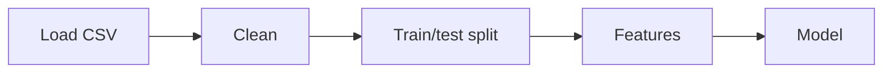

# King County House Prices: Refactoring Project

The original notebook `King-County.ipynb` cleans the King County house sales data, builds new features and trains a price model, all in one long notebook.
This project **refactors** it: the data cleaning and the feature engineering become **tested functions in Python files**, joined with the model training in one **reusable pipeline**. A small **FastAPI app** with a Postgres database runs in **Docker Compose**.
The task itself is described in [`project-description.md`](project-description.md).

## What is in this repository

| File or folder | What it is |
|---|---|
| `King-County.ipynb` | The original notebook (unchanged) |
| `src/` | The refactored code, see [`src/README.md`](src/README.md) |
| `src/cleaning.py` | Data cleaning functions (`clean_data` runs them all) |
| `src/features.py` | Feature engineering: distance functions, the `WaterDistance` transformer, `drop_non_features` |
| `src/pipeline.py` | The reusable pipeline: `run_pipeline()` loads, cleans, splits, builds the features and trains the model |
| `api/` | The FastAPI app (create, read, update, delete houses) with its `Dockerfile` and `docker-compose.yaml`, see [`api/README.md`](api/README.md) |
| `tests/` | 35 tests for the functions, the pipeline parts and the API |
| `bonus_solution/` | Reference material of the template for the optional tasks (not part of my work) |
| `data/` | The King County data set |
| `model/` | The model saved by the original notebook |

## How to run it

```bash
uv sync --locked                                 # create the environment (Python 3.13.17, needs uv 0.13.5 or newer)
uv run pytest                                    # run the 35 tests
uv run python -m src.pipeline                    # run the pipeline as a program, prints the test R²
docker compose -f api/docker-compose.yaml up --build --wait   # start the API and the database
```

The API is then at <http://localhost:8000/docs>. Stop it with `docker compose -f api/docker-compose.yaml down`.
The first time, copy the template for the passwords: `cp api/.env.example api/.env`.

For the notebook, open `King-County.ipynb` and choose the kernel of the project's `.venv`.

## The order of the pipeline



Cleaning learns nothing from the data, so it runs on all houses before the split. The features and the model are fitted on the **training data only**, so no information of the test set leaks in.

## What the functions do

| Step | Function | Result |
|---|---|---|
| Cleaning | `drop_implausible_rows` | Removes the house with 33 bedrooms, by a condition (not by a row number) |
| Cleaning | `rebuild_sqft_basement` | `sqft_basement` becomes `sqft_living - sqft_above`, so the `?` values disappear |
| Cleaning | `fill_missing_with_zero` | Missing `view` and `waterfront` become 0 |
| Cleaning | `add_last_known_change` | Renovation year if renovated, else the build year |
| Features | `add_center_distance` | Distance in km to the center of wealth |
| Features | `WaterDistance` | Distance in km to the nearest waterfront house (one numpy calculation instead of two loops). The reference houses are learned in `fit`, from the training data only |
| Features | `drop_non_features` | Removes `price`, `date` and `id` from the final feature set |
| Model | `build_model` | Polynomial features, scaler and ElasticNet with grid search (as in the notebook) |

The notebook's `sqft_price` is not in the pipeline: it was only used for exploring the data.

## Results

| Check | Result |
|---|---|
| Rows after cleaning | 21,596 (one house removed) |
| Missing values in the features | none |
| Mean `center_distance` | 17.53 km (same as the notebook) |
| Mean `water_distance` | 5.54 km (same as the notebook) |
| Test R² of the model | **0.845** (the notebook shows 0.844) |
| Best parameters | `alpha = 0.01`, `l1_ratio = 0.2` (same as the notebook) |

The small difference in R² is expected: the water distance is fitted on the training data only, and the distance to the center uses the latitude of the center point in both places.

## Checklist

**Core tasks**

- [x] I read and understood the notebook.
- [x] I removed unnecessary code and only kept relevant code for data cleaning and feature engineering.
- [x] I transformed the steps in the Data Preparation and Feature Engineering sections into functions.
- [x] Functions are in separate Python files.
- [x] I built a reusable pipeline.

**Optional tasks**

- [x] I refactored the modeling step and added it to the pipeline. *(The model is not saved yet.)*
- [x] I built a FastAPI app that allows me to create, read, update and delete houses.
- [x] I created a `Dockerfile` and a `docker-compose.yaml` file for the app.
- [x] I built the container with Docker Compose and I am able to run the app inside of it.
- [x] I created tests for my functions and for the API.

## Answers to the three questions

### 1. What steps did you take to complete the project?

1. I read the project description and the notebook, and listed what it does: cleaning, feature engineering, modeling.
2. I decided which parts become reusable functions and which stay in the notebook (exploration and plots).
3. I moved the cleaning steps into `src/cleaning.py` and the feature steps into `src/features.py`, one function per step, with unit tests.
4. I joined everything in `src/pipeline.py`: load, clean, split, features, model.
5. I checked the pipeline on the real data against the numbers of the notebook.
6. I built the API with FastAPI, SQLAlchemy and Pydantic, and tested it with an in-memory database.
7. I wrote the `Dockerfile` and `docker-compose.yaml`, started the stack with Postgres and tried all four operations.

### 2. What challenges did you face?

- **A fixed row number.** The notebook removed the 33-bedroom house with `drop(15856)`. I replaced it with a condition, so it does not depend on the row order.
- **Slow loops.** The water distance was built with two loops. One numpy calculation gives the same numbers.
- **Where does each step belong?** A scikit-learn pipeline step cannot remove rows or split off the target. Cleaning (including dropping rows) therefore runs first, then the split, then the pipeline with the features.
- **Leaking test information.** The water distance uses the waterfront houses as reference points. I made it a transformer that learns them from the training data only.
- **API and model do not fit together.** The model needs all 19 features, the API stores five. The API is therefore CRUD only and does not predict.
- **Docker files in a subfolder.** The image needs `pyproject.toml` and `uv.lock` from the project root, so the build context is the root while the Docker files live in `api/`.

### 3. What would you do differently if you had more time?

- **Save the pipeline and the model** together (skops), and add a `/predict` endpoint to the API that takes all the raw house fields.
- Add **integration tests** for `run_pipeline`.
- Add an **automatic test run** (GitHub Actions) for every push.
- Use **database migrations** (Alembic) instead of creating the tables on startup.
- Add more validation (for example for zip codes) and tests for more edge cases.

## Tools

Python 3.13, pandas, NumPy, scikit-learn, FastAPI, SQLAlchemy, Postgres, Docker, pytest and uv. I used Claude as a coding assistant for the plan, the code and the tests.
