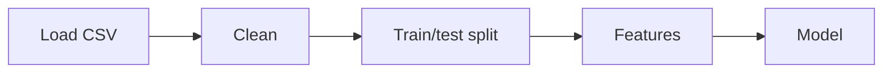

# src: Cleaning, Features and Model Pipeline

The refactored King County notebook as reusable Python modules. The pipeline predicts house prices.

## Flow



Cleaning is stateless (nothing is learned from the data), so it runs on the whole dataset before the split. Features and model are fitted on the training data only, so no test information leaks.

## Files

| File | What it does |
| --- | --- |
| `cleaning.py` | `load_data`, then `clean_data`: drops implausible rows (e.g. 33 bedrooms), rebuilds `sqft_basement`, fills missing `view`/`waterfront` with 0, combines `yr_built`/`yr_renovated` into `last_known_change` |
| `features.py` | `distance_km`, `add_center_distance`, the `WaterDistance` transformer (distance to the nearest waterfront house seen in training), and `drop_non_features` (removes `price`, `date`, `id`) |
| `pipeline.py` | `build_feature_pipeline`, `build_model` (polynomial features + scaler + ElasticNet, grid search with 5-fold CV) and `run_pipeline`, which runs the whole flow |

## Run

From the project root:

```powershell
uv run python -m src.pipeline   # runs the full pipeline, prints the test R²
uv run pytest                   # runs all tests
```

Use `-m src.pipeline`, not `python src/pipeline.py`, so the `src` package is found.

In Python:

```python
from src.pipeline import run_pipeline

results = run_pipeline("data/King_County_House_prices_dataset.csv")
results["test_r2"]   # also: model, feature_pipeline, X_train, X_test, y_train, y_test
```

## Tests

Unit tests are in [`../tests/`](../tests) (`test_cleaning.py`, `test_features.py`). They use small synthetic DataFrames from `conftest.py`. Integration tests for `run_pipeline` are still to do.
